<p align="center">
  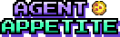
</p>

<p align="center">
  <b>a pixel-art restaurant where the NPCs remember you.</b><br>
  <sub>SOFTWARE ENGINEERING-CTW (4350) &middot; Team 8</sub>
</p>

<p align="center">
  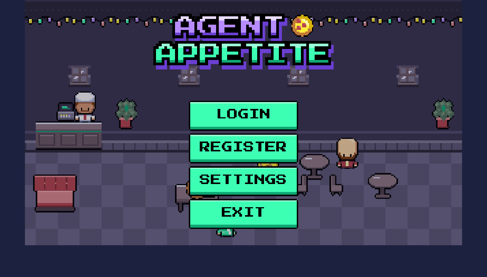
</p>

---

## what is agent appetite

Agent Appetite is a small browser game set in a restaurant. You walk around, talk to the staff and the customers, and they talk back with an AI model. What makes it different is memory: every NPC keeps its own memory of you, remembers what you told it, and reacts with emotion to how you treated it.

The restaurant is only the place where players and NPCs meet. The game is about the conversations, not the food orders.

> **you:** my name is Sweeya.
>
> **Chef Mario:** Nice to meet you, Sweeya!
>
> *(next day, new session, different device)*
>
> **you:** hi again.
>
> **Chef Mario:** Hello again, Sweeya.
>
> **you:** your food is terrible.
>
> **Chef Mario:** That was rude. I will remember that.

## see it

<table>
<tr>
<td align="center" width="50%">
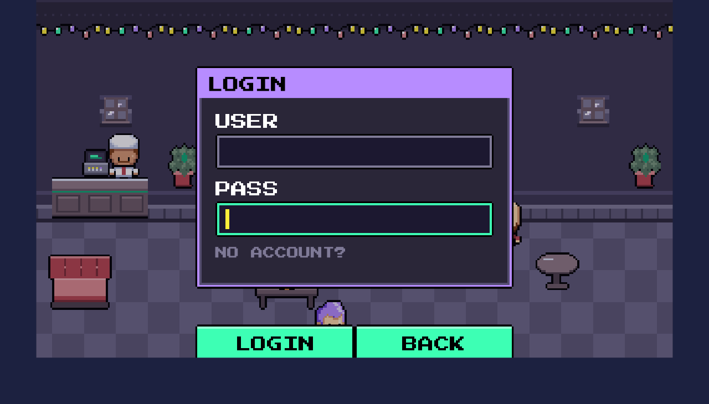<br>
<b>login</b><br>
<sub>accounts keep memory with the player, so it follows you across devices.</sub>
</td>
<td align="center" width="50%">
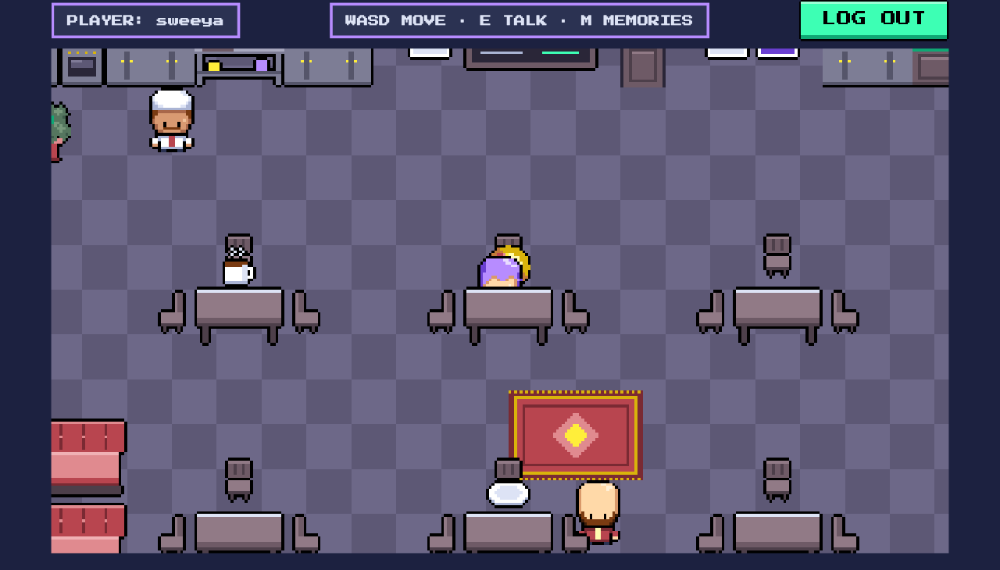<br>
<b>the restaurant</b><br>
<sub>a scrolling 28x16 tile world. walk with WASD or the arrow keys.</sub>
</td>
</tr>
<tr>
<td align="center">
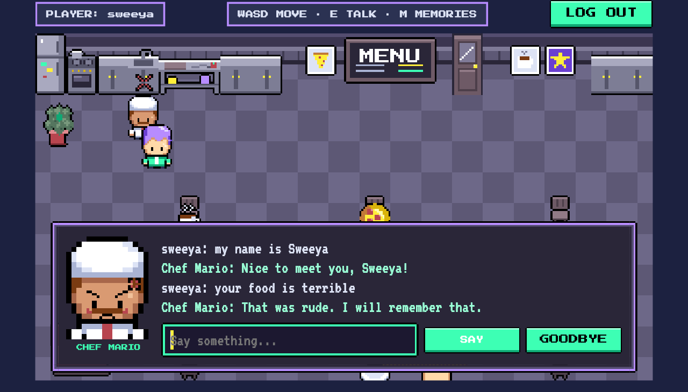<br>
<b>talk to anyone</b><br>
<sub>press E near an NPC. their portrait changes with how they feel.</sub>
</td>
<td align="center">
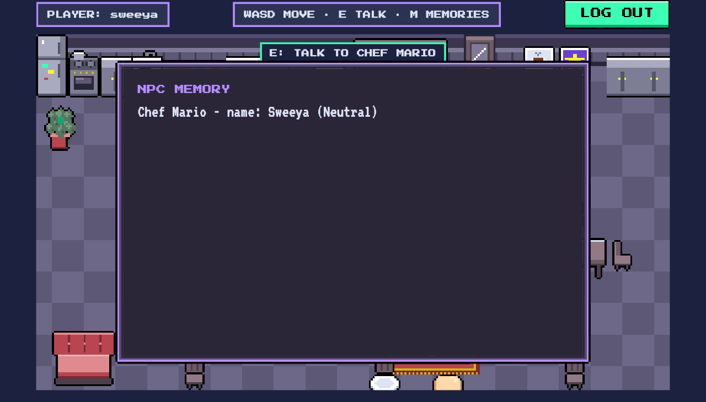<br>
<b>what they remember</b><br>
<sub>press M to see the facts each NPC knows about you.</sub>
</td>
</tr>
</table>

## meet the cast

| | |
| --- | --- |
| **Chef Mario** | runs the kitchen. |
| **Cashier Bruce** | works the register. |
| **Customer Matthew P** | eating at table. has opinions. |
| **You** | the new regular. |

Every character has five moods, and the game switches between them based on the AI's reply. The same person can greet you warmly one day and give you the cold shoulder the next.

<p align="center">
  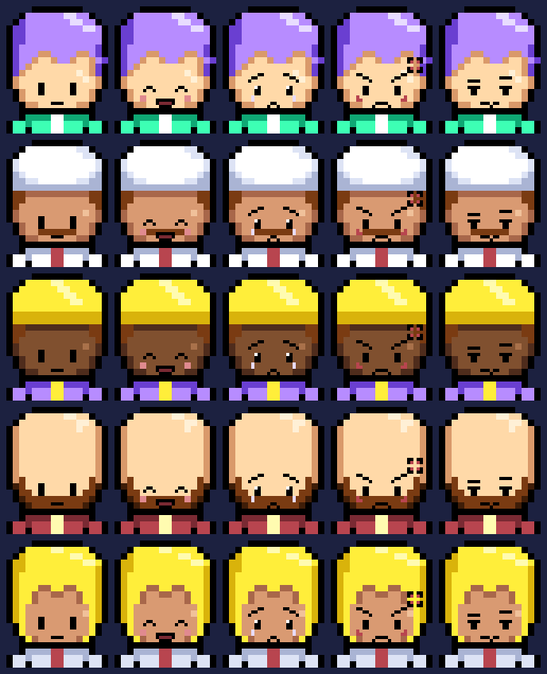<br>
  <sub>neutral &middot; happy &middot; sad &middot; angry &middot; annoyed</sub>
</p>

<p align="center">
  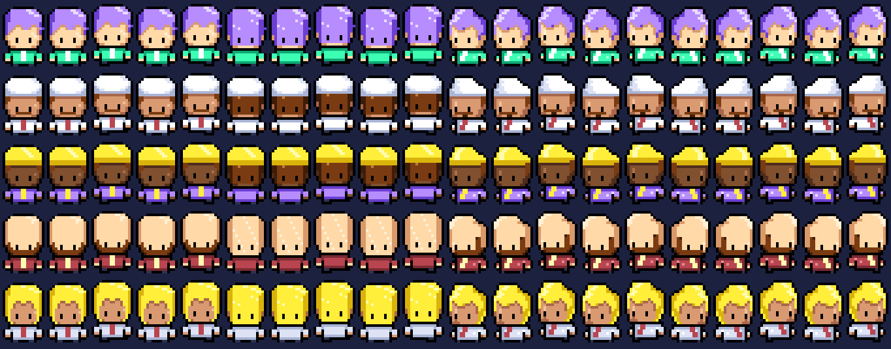<br>
  <sub>four directions, idle plus a four-frame walk cycle, and a talking pose for the NPCs.</sub>
</p>

## how it works

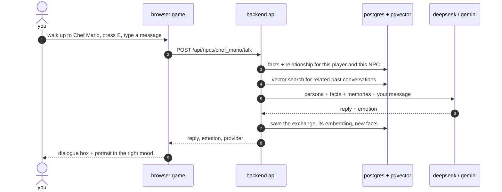

1. **you talk.** the game sends your message with your login token.
2. **the backend remembers.** it loads the facts and mood for this exact player and NPC, and searches past conversations by meaning, not just by exact words.
3. **the model answers in character.** DeepSeek is the first choice. if it fails or is too slow, Gemini takes over without the player noticing.
4. **the game reacts.** the reply comes back with an emotion, which sets the portrait and the icon over the NPC's head.
5. **it all gets saved.** the exchange becomes a fact and a vector embedding, linked to that player and that NPC only.

> Status: the game and the mock backend are playable. The real backend, LLM calls and memory pipeline are being built. See [current status](#current-status).

## architecture

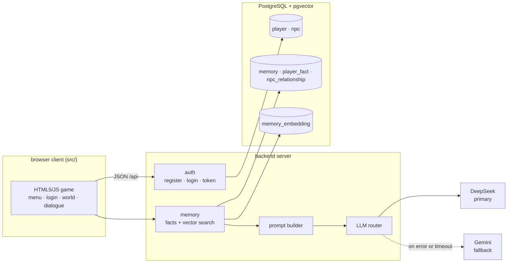

### data model

Every memory row is tied to one player and one NPC. That is what keeps players' memories private from each other and each NPC's memory separate.

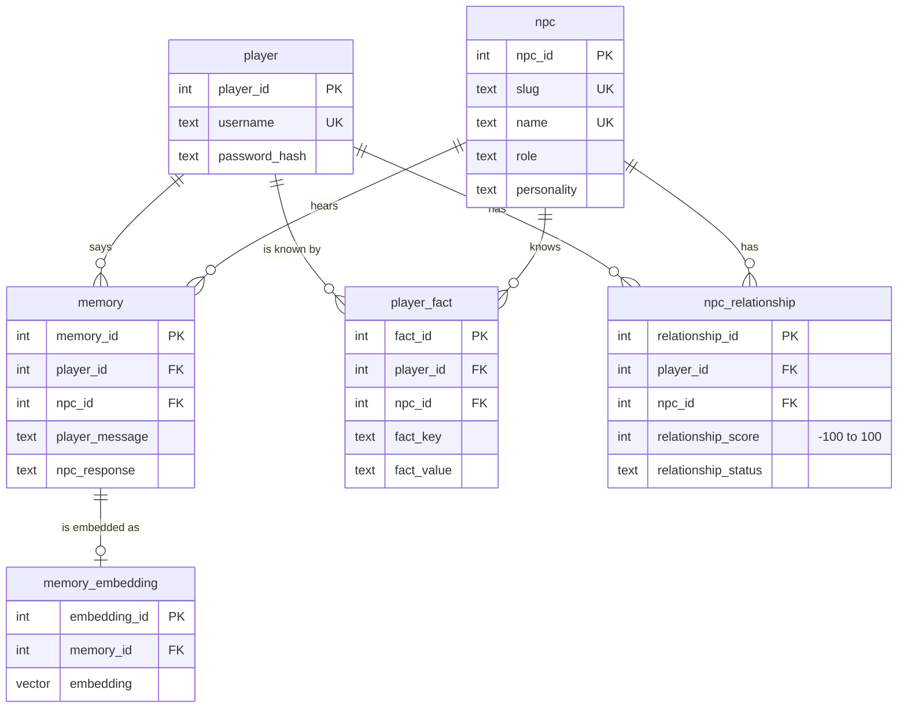

More detail: [docs/architecture.md](docs/architecture.md) and the API contract in [docs/api.md](docs/api.md).

## the art

All of the art is pixel art from one shared palette: characters, portraits, emotion icons, the restaurant, food and the whole UI. It was made with AI tools and then put together for this project.

<p align="center">
  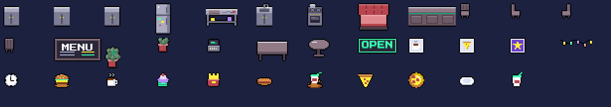<br>
  <sub>kitchen, front of house, decor and food.</sub>
</p>

The asset pack layout and file names are in [assets/PACK_README.txt](assets/PACK_README.txt). The two pixel fonts (Press Start 2P and VT323) use the SIL Open Font License.

## current status

| Area | State |
| --- | --- |
| Browser game (`src/`) | **Playable.** menu, register and login, a scrolling restaurant, smooth movement, NPC dialogue with portraits and emotions, memory panel. Runs against a mock backend in the browser. |
| Backend server (`server/`) | Auth, NPC list and CORS are done. The talk and memory routes are not built yet. |
| LLM client | DeepSeek first, Gemini fallback, with timeouts. Done and tested with fakes, not yet tried against the real APIs. |
| Database (`database/`) | Schema, NPC seed and a pgvector migration. |
| Memory pipeline | **Planned.** fact extraction, embeddings and vector search. |
| Embedding model | **Undecided** (KAN-30). The `vector(1536)` size is a placeholder. |

See [docs/test-plan.md](docs/test-plan.md) and [docs/sprint-report.md](docs/sprint-report.md).

## run it

The game loads its art from `assets/`, so serve the repo root over HTTP. Opening the file directly will not work.

```
python3 -m http.server 8000
```

Then open <http://localhost:8000/src/main.html>.

| Key | Action |
| --- | --- |
| `W` `A` `S` `D` or arrows | walk |
| `E` | talk to the NPC next to you |
| `M` | what the NPCs remember about you |
| `F11` | full screen |

The game plays against an in-browser mock by default, so accounts and memories live in your browser only. Add `?api=1` to use a backend on `localhost:3000`, or open the game through the backend itself at <http://localhost:3000/src/main.html>.

### the backend

Needs Node.js 22+ and PostgreSQL 16 with the [pgvector](https://github.com/pgvector/pgvector) extension.

```
cp .env.example .env
createdb agent_appetite
psql agent_appetite -v ON_ERROR_STOP=1 -f database/schema.sql
for f in database/migrations/*.sql; do psql agent_appetite -v ON_ERROR_STOP=1 -f "$f"; done
psql agent_appetite -f database/seed_npcs.sql
npm ci && npm start
```

| Variable | Purpose |
| --- | --- |
| `DATABASE_URL` | Postgres connection string |
| `JWT_SECRET` | signs login tokens |
| `PORT`, `CORS_ORIGIN` | server port and allowed origin |
| `DEEPSEEK_API_KEY` | primary LLM |
| `GEMINI_API_KEY` | fallback LLM |

Never commit `.env`.

### tests

```
npm test
```

## project structure

```
.
├── src/                 browser game (main.html, game.js, scene.js, sprites.js, world.js, map.js, movement.js, api.js, httpApi.js)
├── server/              express api: auth, npcs, llm client
├── database/            schema.sql, migrations/, seed_npcs.sql
├── assets/              pixel art: characters, portraits, world, ui, fonts
├── docs/                api contract, architecture, test plan, sprint report, screenshots
├── tests/               node test runner suites
├── .github/             CI workflow and PR template
└── *.docx, *.pdf, *.drawio   requirements, team contract, ERD and use-case diagrams
```

## contributing

- Branch from `main` (`feature/...`, `fix/...`, `docs/...`), open a pull request with the template, and get one teammate review before merging.
- Prefix commits and PR titles with `[Feature]`, `[Fix]`, `[Test]`, `[Docs]` or `[Chore]`, and reference the Jira ticket (KAN-xx) where there is one.
- `docs/api.md` is the shared contract. Change it only in a PR that updates every consumer.
- CI runs the tests, applies the schema to a fresh pgvector Postgres, and rejects AI co-author trailers on pull requests.

## team

| Member | Role |
| --- | --- |
| Joshoua Hossain | TODO: role |
| Sweeya Ghanta | TODO: role |
| Arturo Hernandez | TODO: role |
| Jomari Ingol | TODO: role |
