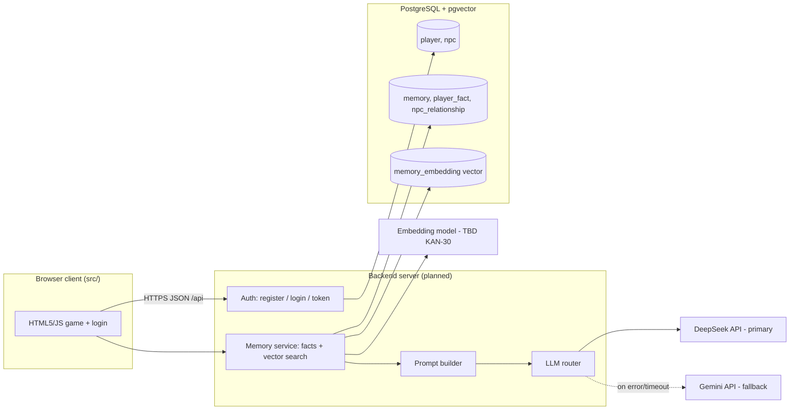

# Architecture

Status: the browser client exists (with a mock API). The backend, LLM integration and embedding pipeline are **planned** and are being built on branches. The API they must expose is in [api.md](api.md).

## Components

- **Browser client**: renders the world, handles movement and proximity to NPCs, shows dialogue and a memory panel. Holds only a token; all memory lives server-side so it persists across sessions and devices.
- **Backend server**: authenticates players, retrieves memory, builds prompts, calls the LLM and writes results back.
- **Database**: `player`, `npc`, `memory` (messages), `player_fact` (key/value facts), `npc_relationship` (score -100..100 and status), `memory_embedding` (pgvector, indexed by `(player_id, npc_id)` and HNSW cosine). Every memory row is keyed by player + NPC, which gives the isolation rules in api.md.
- **LLM router**: tries DeepSeek first, falls back to Gemini on failure; returns 502 if both fail. The response reports which `provider` answered.

## Request flow: one NPC conversation (`POST /api/npcs/:id/talk`)

1. Client sends the message with the bearer token.
2. Backend validates the token and message (1-500 chars) and resolves the NPC.
3. **Retrieve facts**: load `player_fact` and `npc_relationship` rows for this `(player_id, npc_id)` pair only.
4. **Vector search**: embed the message, query `memory_embedding` filtered by `(player_id, npc_id)` ordered by cosine distance, and take the top-k past memories.
5. **Build prompt**: NPC personality + relationship status + facts + retrieved memories + recent turns + the new message, with instructions to answer in character and return an emotion.
6. **LLM call**: DeepSeek; on error or timeout, Gemini.
7. **Write back**: store the exchange in `memory`, store its embedding, upsert any new facts, update the relationship score.
8. Respond `{ reply, emotion, provider }`. Target latency is under about 5 seconds.

TODO (team): decide how facts are extracted (LLM structured output vs rules), top-k and token budget, and the embedding model and dimension (KAN-30). The schema's `vector(1536)` is a placeholder.
